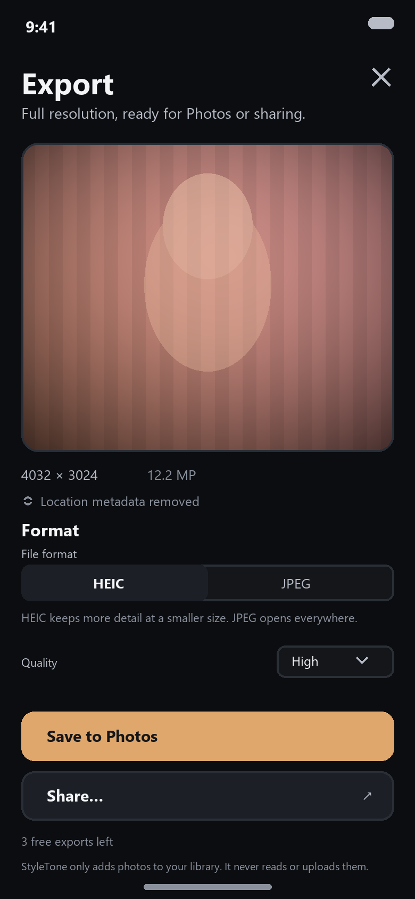
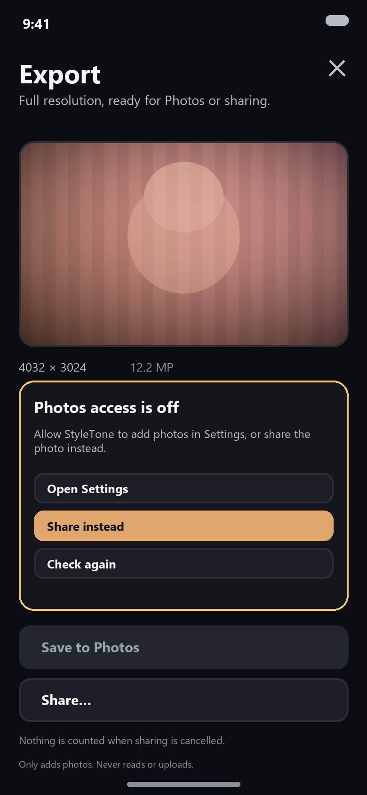
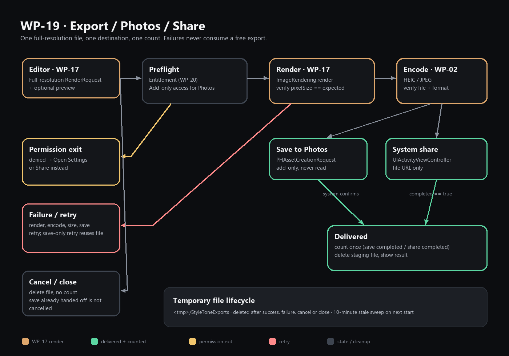

# WP-19 · 导出 / 相册 / 分享

- 状态：**review**（实现与测试已写入；本会话为 Windows，`swift test` / iOS 构建待 macOS CI）
- 依赖：WP-02 `ImageExporting`、WP-17 `ImageRendering`、WP-20 额度实现
- 解锁：WP-23 边界态、WP-24 性能/集成
- 契约：新增 UI-owned 协议/展示类型已登记在 [`CCR.md`](CCR.md)（**proposed**，未改 `core-v1`）
- 范围：`Packages/StyleToneUI/Sources/StyleToneUI/Export/`、`Packages/StyleToneUI/Tests/StyleToneUITests/Export/`
- 文档/资产：`Packages/StyleToneUI/Export/`（本 README、`Integration/`、`screenshots/`）

> 任务卡写的所有权目录是 `Packages/StyleToneUI/Export/`，而本仓库 SwiftPM target 实际在
> `Packages/StyleToneUI/Sources/StyleToneUI`。与 WP-09 相同，实现放在
> `Sources/StyleToneUI/Export/`，任务卡目录放文档与集成片段；两边都不触碰 `Editor/`、
> `Imaging/`、`Core/`、`DesignSystem/`。

---

## 1. 交付内容

| 能力 | 实现 |
|---|---|
| 全分辨率导出 | WP-17 渲染尺寸 + ImageIO 读出的实际编码文件尺寸都必须等于 `ExportSource.expectedPixelSize`；不一致就失败，不导出代理图 |
| 文件编码 | 调 WP-02 `ImageExporting`；HEIC / JPEG；质量 0.85 / 0.92 / 1.0 |
| PhotoKit add-only | `PhotoKitExportPhotoLibrary` 只用 `PHAssetCreationRequest` 与 `.addOnly`；无 `PHAsset` fetch / `PHImageManager` / 读权限 |
| 系统分享 | `UIActivityViewController` 包装；完成回调才计数；取消不计数 |
| 进度 | 阶段 + 单调 fraction（不伪造字节进度），见 §4 |
| 取消 | UI 立即显示取消；渲染在下一个检查点停止；同步 ImageIO 编码无法中途打断，返回后丢弃并删除文件；交给 PhotoKit 后不可取消（可能已保存） |
| 重试 | 渲染/编码失败重跑全流程；仅保存失败时复用已编码文件，不重复渲染 |
| 默认去 GPS | `ExportOptions.stripLocation = true` 且 UI 不提供关闭开关；WP-02 writer 从裸 `CGImage` 编码，不复制源 EXIF/GPS |
| 权限拒绝出口 | 失败卡提供 Open Settings / Share instead / Retry / Dismiss；权限卡常驻显示 |
| 失败不扣次数 | 只有相册保存成功或分享完成才调用 `ExportQuotaServicing.recordSuccessfulExport()` |
| 临时文件 | 成功 / 取消 / 关闭删除；失败默认删除，仅相册保存失败/权限被 PhotoKit 拒绝时保留给 Share instead / Retry；启动时清扫超过 10 分钟的孤儿文件 |
| 无障碍 / 文案 | `export.*` 标识；`editor.export.*` / `error.export.*` 键；英文 fallback |
| 测试 | 9 个测试类（+1 个支持文件），80 个 XCTest（模型驱动 + 真实 ImageIO 编解码/性能测试） |

---

## 2. 流程

```text
Editor (WP-17) 提供完整 RenderRequest + 可选预览
        │
        ▼
ExportViewModel.begin(destination)
        │
        ├─ 0. 额度预检（WP-20）           ── exhausted → 付费墙出口
        │
        ├─ 1. 相册目的地：add-only 授权预检  ── denied/restricted/unavailable
        │                                           → 失败卡 + 分享/设置出口
        │
        ├─ 2. renderer.render(request)     ── 校验像素尺寸 == expectedPixelSize
        │
        ├─ 3. exporter.export(image)       ── 校验文件存在、格式、尺寸
        │        └─ 得到 staging URL（<tmp>/StyleToneExports/…）
        │
        ├─ 4a. 保存：photoLibrary.save(file)
        │        └─ 成功 → recordSuccessfulExport() → outcome → 删除文件
        │
        └─ 4b. 分享：pendingShare = file
                 └─ 系统完成 → recordSuccessfulExport() → outcome → 删除文件
                 └─ 用户取消 → 删除文件，info banner，不计数
```

### 状态机（`ExportStage`）

| 事件 | stage | 说明 |
|---|---|---|
| 打开面板 | `idle` | 加载授权 + 额度 |
| 点击保存/分享 | `preparing` | 额度与参数检查 |
| 相册目的地 | `requestingAccess` | 只在需要时请求 `.addOnly` |
| 开始渲染 | `rendering` | 0.10 → 0.60 |
| 编码 | `encoding` | 0.62 |
| 保存 / 分享中 | `savingToLibrary` / `awaitingShare` | 0.94 |
| 成功 | `finished` | 1.0，outcome 不含像素 |
| 失败 | `failed` | 展示可执行恢复动作 |
| 取消 | `cancelled` | 提供 Try again |

### 取消语义

- `preparing` / `requestingAccess` / `rendering`：立即取消 `Task`，清理已产生的文件。
- `encoding`：UI 立即进入取消；WP-02 `ImageWriter` 是同步 ImageIO 编码，无法中途打断，
  返回后导出侧检查 `Task.isCancelled` 并删除整份文件（不会留下半成品或计数）。
- `savingToLibrary`：**不取消**。PhotoKit 可能已经写入相册；UI 隐藏取消按钮，等待结果并计数。
- `awaitingShare`：关闭分享面板、删除文件、不计数。若系统 completion 一直没到达而面板已关闭，
  `onDisappear` 会调用 `abandonShareIfPending()` 清理并回到 `idle`，不会永久卡在 busy。

### 重试语义

| 失败点 | Retry 行为 |
|---|---|
| 渲染 / 尺寸不符 / 编码 | 重新渲染 + 编码 |
| 权限预检（Settings 返回后） | `refreshAuthorization()` 后重跑；权限卡也会自动消失 |
| 相册保存 / PhotoKit 拒绝 | 若 staging 文件仍在：只重试 `save`，不重复渲染；否则重跑 |
| 分享不可用 | 失败卡给“Save to Photos instead” |

---

## 3. 界面

| 导出面板 | 权限被拒 / 出口 |
|---|---|
|  |  |



> 截图由 `tools/render_screens.py` 用同一套设计 token 与 `ExportCopy` 英文 fallback 渲染，是
> **设计稿级流程图**，不是模拟器截图（本会话为 Windows，无 Xcode/Simulator）。真机界面以
> SwiftUI 源码为准；WP-24 再接真机截图。

---

## 4. 进度

`ExportProgress` 由 `stage + fraction` 组成，UI 同时显示阶段文案、百分比与线性进度条。
fraction 只在阶段边界前进，不做假动画：

| 阶段 | fraction |
|---|---:|
| preparing | 0.02 |
| requestingAccess | 0.05 |
| rendering（开始 / 完成） | 0.10 / 0.60 |
| encoding | 0.62 |
| savingToLibrary / awaitingShare | 0.94 |
| finished | 1.00 |

WP-17 / WP-02 当前协议没有字节级进度回调；若后续需要更细进度，应通过新协议扩展（CCR），
而不是在 UI 里按时间猜。

---

## 5. 相册权限

`ExportPhotoLibrary` 是 UI 自己的 add-only 协议：

```swift
public protocol ExportPhotoLibrary: Sendable {
    func authorizationStatus() async -> PhotoLibraryAccess
    func requestAddOnlyAccess() async -> PhotoLibraryAccess
    func save(_ file: ExportStagedFile) async throws
}
```

- 只用 `PHPhotoLibrary.requestAuthorization(for: .addOnly)`；不请求读权限。
- 只用 `PHAssetCreationRequest.forAsset().addResource(with: .photo, fileURL:options:)`；
  不 fetch、不读缩略图、不列相册。
- `PhotoLibraryAccess`：`notDetermined / authorized / limited / denied / restricted / unavailable`。
  `limited` 视为可添加。
- 缺 `NSPhotoLibraryAddUsageDescription` 时返回 `.unavailable` 并降级为“只可分享”，
  避免 PhotoKit 因缺 usage description 直接 crash。**但正式 App 必须加这个 key**：
  见 [`Integration/Info.plist.fragment`](Integration/Info.plist.fragment) 与 §9。
- 权限出口：
  - denied → Open Settings + Share instead + Check again（失败卡另有 Dismiss）；
  - restricted → Share instead + Check again（失败卡 Dismiss）；
  - unavailable（构建/平台）→ Share instead + Check again；
- `scenePhase == .active` 时重新读取授权状态，从 Settings 回来无需重启面板。

---

## 6. 全分辨率、格式与 GPS

### 全分辨率

`ExportSource` 同时带完整 `RenderRequest` 与可选 `preview`。导出前：

1. `renderer.render(source.request)` 必须返回 `expectedPixelSize`（默认取 `request.image.pixelSize`）；
2. 编码完成后用 ImageIO 读取**实际文件**的像素尺寸与容器格式（只读元数据，不解码像素）；
3. `ExportResult` 自报的尺寸/格式必须与实际文件一致，实际文件又必须与
   `expectedPixelSize` / `ExportSettings.format` 一致；
4. 不一致 → `resolutionMismatch` / `encodeFailed`；不保留文件、不计数。若编码器已经写出文件，
   导出侧会在校验失败后删除它。

这防止 WP-17 或编辑器误把预览代理传进来时静默导出低清图。集成要求：编辑器打开导出面板时，
`RenderRequest.image` 必须是全分辨率原图，预览通过 `ExportSource.preview` 单独传入。

### 格式 / 质量

| 选项 | 值 |
|---|---|
| HEIC（默认） | `.heic`，扩展名 `heic` |
| JPEG | `.jpeg`，扩展名 `jpg` |
| Standard | 0.85 |
| High（默认） | 0.92 |
| Maximum | 1.0 |

### GPS / 元数据

- `ExportSettings.stripLocation` 默认 `true`，面板不提供关闭开关。
- WP-02 `ImageWriter` 从裸 `CGImage` 编码，不复制源文件的 EXIF/GPS；因此 HEIC/JPEG 都不带位置。
- 若未来换用会复制元数据的 `ImageExporting` 实现，必须自行尊重 `stripLocation`；否则本 WP 的
  “默认去 GPS”不再成立，需要 CCR + 隐私评审。

### 48MP / 大图

`ExportSource.isLargeImage` 在 ≥24MP 时提示“最多约 20 秒”；不阻塞导出。真正 48MP 的耗时/内存
由 WP-24 在设备上测量。

---

## 7. 免费额度计数（WP-20 接口）

```swift
public protocol ExportQuotaServicing: Sendable {
    func entitlement() async throws -> ExportEntitlement
    func recordSuccessfulExport() async throws
}
```

- `start()`、额度重试、以及回到前台时读取 entitlement；每次尝试使用缓存额度。购买完成后宿主应调用
  `viewModel.refreshEntitlement()`（见 §9 的集成方式），否则已购状态要等到下次打开面板才生效。
- `exhausted` 时不渲染，直接给付费墙出口。
- 只有以下两种情况下调用 `recordSuccessfulExport()`：
  - `photoLibrary.save(file)` 成功返回；
  - 系统分享 completion 报告 `completed == true`。
- 渲染失败、编码失败、尺寸不符、权限拒绝、保存失败、分享取消、用户取消都不计数。
- 保存/分享成功后 WP-20 写计数失败时，照片已经交付：界面仍显示成功，`counted == false` 并提示
  “免费导出次数未更新”；同时进入 fail-closed 的额度不可用状态（`quotaLoadFailed`），阻止下一次
  导出，直到 `refreshEntitlement()` 重新读取成功。不会把成功保存伪装成失败，也不会因写失败而
  继续无限免费导出。
- 默认 `UnavailableExportQuota`（fail closed）：WP-20 未接入时额度读取失败，面板显示
  “Couldn't check your exports”，Save/Share 禁用；不会意外变成无限免费。`UnlimitedExportQuota`
  仅供预览/测试或明确不设付费墙的构建。正式 App 必须注入 WP-20 实现。

> 产品语义按契约“保存/分享均计数”：同一张图先保存再分享会各计一次。若产品希望“一次导出只计一次”，
> 需要在 WP-20/产品侧确认，并在 `ExportViewModel` 增加 session 级去重（见 §12 风险 4）。

---

## 8. 临时文件

`ExportTemporaryFileStore` 与 WP-02 默认目录一致：`<tmp>/StyleToneExports/`，直接使用
`FileImageExporter.defaultDirectoryName`，不再复制字符串。

| 路径 | 行为 |
|---|---|
| 保存成功 / 分享完成 | `finishSuccess` → 删除 staging 文件 |
| 分享取消 / completion 丢失 | 删除；completion 丢失时关闭面板走 `abandonShareIfPending()` |
| 失败且不提供“分享替代” | 立即删除 |
| 失败但保存了 staging（相册保存失败/权限被 PhotoKit 拒绝） | 保留给 Share instead / Retry；Dismiss / Close / 下一次导出时删除 |
| 关闭面板 | `prepareForClose()` 删除；保存进行中则等保存任务收尾后删除 |
| App 被杀 / 崩溃 | 下次 `start()` 清扫 10 分钟前的孤儿文件 |
| 清理边界 | 只删除目录的直接子文件；目录外 URL 一律拒绝（单测覆盖） |
| 文件保护 | 编码前创建目录并设 `NSFileProtectionComplete`（文件继承），编码后对文件再设一次；任一步失败不阻塞导出，文件仍随机命名、位于 `tmp/`、随后删除 |

不存在“导出成功后长期留在磁盘”的路径；失败时为了 Share instead/Retry 保留的 staging 文件会在
Dismiss / Close / 下一次导出时删除，崩溃时最晚在下次启动 + 10 分钟阈值被清扫。

---

## 9. 集成

```swift
import StyleToneImaging
import StyleToneUI

// App composition root（可以 import Imaging / Commerce）
let exporter = FileImageExporter()                 // WP-02
let library = PhotoKitExportPhotoLibrary()         // WP-19，iOS
let quota: any ExportQuotaServicing = appQuotaService // WP-20；宿主提供，本仓库未落地
// 示例中的 appQuotaService / presentPaywall 都是宿主代码，不是 StyleToneUI 的类型。

let dependencies = ExportDependencies(
    renderer: editorRenderer,                      // WP-17 ImageRendering
    exporter: exporter,
    photoLibrary: library,
    quota: quota,
    logger: logger,
    dateProvider: SystemDateProvider(),
    fileStore: ExportTemporaryFileStore(),
    supportsSystemShare: true
)

let source = ExportSource(
    request: fullResolutionRequest,                // image 必须是全分辨率
    preview: editorPreview                          // 只用于面板预览
)

let exportModel = ExportViewModel(
    source: source,
    dependencies: dependencies,
    settings: ExportSettings(format: .heic, quality: .high)
)

ExportScreen(
    viewModel: exportModel,
    onClose: { dismissExport() },
    onUpgrade: {
        presentPaywall {
            // WP-20 购买/恢复完成后刷新，否则面板仍按旧额度禁用导出。
            Task { await exportModel.refreshEntitlement() }
        }
    }
)
```

### Info.plist（必须）

把 [`Integration/Info.plist.fragment`](Integration/Info.plist.fragment) 的
`NSPhotoLibraryAddUsageDescription` 合入 `App/Info.plist`。没有它，系统权限弹窗会终止 App；
本实现会 fail closed 为 `.unavailable`，但正式包仍需声明。WP-26 落地 `zh-Hans` 时同时补
`InfoPlist.strings`。

### PrivacyInfo.xcprivacy（必须）

`removeStaleFiles` 读取文件修改时间（file timestamp required-reason API）。把
[`Integration/PrivacyInfo.xcprivacy.fragment`](Integration/PrivacyInfo.xcprivacy.fragment)
的 `C617.1` 条目合并进 App 的 `PrivacyInfo.xcprivacy`；若 WP-21 已有清单，合并数组而不是覆盖。

### 目录一致性

`FileImageExporter`（WP-02）与 `ExportTemporaryFileStore` 必须指向同一个目录；两者默认都是
`<tmp>/StyleToneExports`。若宿主给 exporter 注入自定义目录，必须同时把相同目录传给 file store，
否则 `ExportViewModel` 会把编码结果判为 `missingOutput`（fail closed，不会误保存/误计数）。

### 当前 App 集成状态（未完成，需 WP-03/24 接线）

| 项 | 状态 |
|---|---|
| 路由 | `AppRoute.export` 仍指向 `ExportPlaceholderScreen`（`App/AppShell/AppShellView.swift`），尚未替换为 `ExportScreen` |
| 依赖注入 | `AppDependencies` 没有 `ExportDependencies` / `ExportPhotoLibrary` / `ExportQuotaServicing` |
| 相册 usage key | `App/Info.plist` 缺 `NSPhotoLibraryAddUsageDescription`，见上方 fragment |
| 渲染器 | WP-17 `ImageRendering` 尚未落地；本会话用 mock 验证 |
| 额度 | WP-20 / `StyleToneCommerce` 未落地；默认 fail-closed，购买后刷新需要宿主调用 |
| UI test | 无 XCUITest target；本 WP 的 UI 测试是模型脚本 + 视图构造 |

这些都在 Export 目录之外；本会话按“只改 Export”约束没有改 App、Core、Imaging 或 WP-20，
因此**真实 App 里还不能从编辑器走到本面板**。WP-03/24 按上面的依赖和 fragment 接线后即可。
具体改动建议与 UI 测试清单见 [`Integration/AppWiring.md`](Integration/AppWiring.md)。

### 分享平台

`ExportShareSheet` 用 `UIActivityViewController`，只在 UIKit 平台显示分享按钮；macOS（SwiftPM
测试构建）下 `supportsSystemShare = false`，界面只提供保存入口。App target 为 iPhone-only。

---

## 10. 无障碍 / 文案

- 屏根标识：`export.root`（等于 `AppRoute.export.accessibilityID`）。
- 复用冻结标识：`export.exportButton`（Save）、`export.closeButton`（Close）。
- 新增：`export.shareButton`、`export.preview`、`export.pixelSize`、`export.formatPicker`、
  `export.qualityPicker`、`export.quota`、`export.progress` / `.value`、`export.cancelButton`、
  `export.permissionNotice`（settings/share/retry）、`export.failure`（每个 recovery 独立按钮）、
  `export.result` / `.doneButton` / `.detail` / `.countPending`、`export.infoNotice`、
  `export.cancelledNotice`、`export.quotaNotice`（upgrade/retry）。
- 文案全部走 `ExportText`（`LocalizationKey` + 英文 fallback）；无硬编码中文。
- 契约 §8 的前缀表没有 `export`，所以面板文案用 `editor.export.*`，错误文案用 `error.export.*`；
  Close 复用 WP-03 保留的 `common.closeButton`。WP-26 需要把这些 key 收进字符串目录。
- 颜色/间距/字体只用 `StyleToneTheme` token 与 `PrimaryButton` / `PhotoCanvas` / `SectionHeader`。

---

## 11. 测试

```bash
# macOS（CI 同款）
swift test --filter Export

# 单独类
swift test --filter ExportPipelineTests
swift test --filter ExportPermissionTests
swift test --filter ExportPerformanceTests
```

| 文件 | 数量 | 覆盖 |
|---|---:|---|
| `ExportPipelineTests` | 25 | 保存/分享全流程、同文件、计数、Sheet 关闭竞态/放弃、实际文件尺寸校验、渲染/编码/尺寸/缺文件失败、重试、取消、分享不可用、额度耗尽/写失败、忙时禁改设置 |
| `ExportPermissionTests` | 7 | notDetermined 请求一次、denied 在渲染前失败、restricted/unavailable 出口、Settings 后重试、PhotoKit 拒绝后只重存不重编、denied 时仍可分享 |
| `ExportFailureTests` | 13 | 错误映射、恢复动作、诊断码、进度/额度/质量/设置/来源/暂存文件/权限值类型 |
| `ExportCopyTests` | 9 | key 合法性/唯一性/前缀、失败与恢复文案、进度文案、额度单复数、格式化 |
| `ExportAccessibilityTests` | 5 | 冻结标识复用、合法性/唯一性、恢复按钮、嵌套标识 |
| `ExportPrivacyAuditTests` | 6 | 无网络/读相册/读文件内容/日志路径；add-only 与 creation-only；临时文件清理与保护证据；Info.plist 与 PrivacyInfo 片段 |
| `ExportTemporaryFileTests` | 5 | 默认目录、只清旧文件、目录外拒绝、幂等删除、字节数 |
| `ExportScreenTests` | 9 | 屏构造、fail-closed 默认、验收常量、保存→分享脚本、权限脚本、额度脚本、关闭清理、大图提示 |
| `ExportPerformanceTests` | 1 | 4032×3024 预热 1 次 + 连续 10 次真实 ImageIO 编码，插值 p95 ≤ 6s，逐次校验无残留 |

### 验收映射

| 验收 | 证据 |
|---|---|
| 12MP p95 ≤6s（契约验收） | **未验证**。`ExportPerformanceTests` 只提供 macOS 上的编排 + 平台 ImageIO 编码预算回归（预热 1 + 10 次，插值 p95 ≤6s）；不含 WP-17 真实渲染，也不是 iPhone 13 测量。WP-24 必须测完整管线。 |
| 失败可重试 | `testRenderFailureIsRetryableAndDoesNotCount`、`testEncodeFailureIsRetryableAndDoesNotCount`、`testDeniedAtStartSucceedsAfterSettingsAreOpenedAndRetried`、`testPhotoKitSaveRejectionKeepsFileAndRetriesWithoutReencoding` |
| 权限拒绝有出口 | `testDeniedPromptFailsBeforeRenderingAndOffersExits`、`testRestrictedLibraryOffersOnlyShareAndDismiss`、`testUnavailableLibraryOffersShareExit`、权限卡 Settings/Share/Check again |
| 不产生长期临时文件 | `ExportTemporaryFileTests`；成功/取消/拒绝后目录为空；保留 staging 的失败用例断言 1 个文件，并在 dismiss/share/retry/close 后断言清空；启动清扫 |
| 保存/分享成功计数 | `testSaveExportsFullResolution…`、`testShareWaitsForSystemCompletion…`、`testFreeQuotaDecrementsOnlyAfterEachSuccess`、`testFlowScriptSaveThenShareCountsEachDeliveredExport` |
| 失败/取消不计数 | 所有失败/取消测试断言 `recordCount == 0`，唯一例外是“照片已交付但额度写失败”的 `testQuotaRecordFailure…`（`counted == false` + fail-closed，不再允许下一次导出）；`testCancelledShare…` |
| 全分辨率 | `testSaveExportsFullResolution…`、`testProxySizedRenderIsRejectedBeforeEncoding`、`testExporterSizeMismatchFailsAndCleansTheFile`、`testLyingExporterMetadataIsCaughtByReadingTheEncodedFile`（ImageIO 读实际文件） |
| 默认去 GPS | `testFormatQualityAndLocationOptionsAreForwarded`（`stripLocation == true`）+ WP-02 writer 不复制元数据；无 UI 关闭入口 |
| 文件与相册一致 | `testSaveExportsFullResolution…` 断言相册 mock 收到与 exporter 相同的 URL；`testLyingExporterMetadata…` 用 ImageIO 读取实际文件尺寸，防止 exporter 谎报。真实 PhotoKit 写入待 WP-24。 |
| PhotoKit add-only | 源码静态审计 `testPhotoKitUseIsAddOnlyAndCreationOnly` + `FakePhotoLibrary`；真实 PhotoKit 执行待 WP-24。 |
| UI/集成测试（mock PhotoKit） | 9 个测试类（+1 支持文件）、80 个测试；`FakePhotoLibrary` / `GatedPhotoLibrary` 替代 PhotoKit |

> 本会话没有 Swift/Xcode，**未执行** `swift test` 或 `xcodebuild`。已用 tree-sitter Swift 语法树解析
> 全部 22 个源/测试文件（除该语法树对 `#if` 指令的已知误报外，无语法错误节点），并跑静态
> key/identifier/隐私扫描。类型检查、iOS/PhotoKit 分支与真实 CI 状态：**pending**。

---

## 12. 风险 / 未决

1. **CI 未跑**：Windows 无 Swift/Xcode。高风险编译点：
   `PhotoKitExportPhotoLibrary` 的 `PHPhotoLibrary` 完成回调桥接（`#if os(iOS)`）、
   `UIActivityViewController` completion 的 `@Sendable` 桥接、`ExportSharePresenter` 里
   `Binding(get:set:)` 的 sheet binding，以及 `Task<Void, Never>` 的闭包返回类型。需要 macOS
   runner 优先验证。
2. **Info.plist 缺 key**：当前 `App/Info.plist` 没有 `NSPhotoLibraryAddUsageDescription`；本会话
   按约束只改 Export，提供了 fragment。合入前必须由 App owner 加 key，否则真实保存只能走
   `.unavailable` 分支（不会 crash，但功能不完整）。
3. **WP-17 未落地**：用 `ImageRendering` mock 验证。编辑器接入时必须传全分辨率 `RenderRequest`；
   若 WP-17 改变输出尺寸（裁切/拉长改变画布），当前严格相等校验会拒绝导出，需要 CCR 明确策略。
4. **计数语义**：契约写“保存/分享均计数”，所以同一张图保存后再分享会各计一次。产品若希望
   “一次导出只计一次”，需要 WP-20 与产品确认，并在本 flow 增加 session 去重。
5. **性能证据**：12MP 测试是预热 1 次 + 10 次 macOS 平台 ImageIO 编码 + 导出编排（插值 p95），
   编码器是测试侧替身，不包含 WP-17 真实渲染，也不代表 iPhone 13 的 HEVC 硬件编码。WP-24 必须在
   设备上测完整管线并记录 p95/内存。
6. **色彩空间**：Core `ExportOptions` 只有 `stripLocation`，没有输出色彩空间；WP-02 默认 sRGB。
   P3 原图会被转 sRGB。若要保留 Display P3，需要 CCR 扩展 `ExportOptions` 或由 App 注入
   `ImageWriter` 配置。
7. **元数据**：去 GPS 的安全性依赖 WP-02 writer 不复制源元数据；若未来替换 exporter，需要重新
   验证 `stripLocation`。本 UI 只传 flag，不解析/重写 EXIF。
8. **分享完成语义**：`UIActivityViewController` 的 `completed == true` 包括“存储到文件”等非相册
   动作，按契约都算一次分享；若产品只接受“分享到第三方”，需要更细的 activity 过滤。
9. **多场景/多面板**：启动清扫按 10 分钟阈值删除目录内旧文件；App 只支持单窗口 iPhone，若未来
   iPad 多窗口同时导出，需要按 session 隔离目录或改为文件所有权表。
10. **无 XCUITest**：当前“UI 测试”是模型脚本 + 视图构造 + 标识契约；真正点击/截图/权限弹窗
    测试需要 WP-24 的 UI test target。
11. **本地化**：`editor.export.*` / `error.export.*` 尚未进入字符串目录；WP-26 需要补齐 zh-Hans，
    并与 `InfoPlist.strings` 的相册用途文案对齐。
12. **保存中关闭**：保存交给 PhotoKit 后关闭面板，任务仍会收尾并计数；用户看不到成功卡。若产品
    要求“关闭即取消保存”，PhotoKit 没有取消 API，需要改为等待保存完成再允许关闭。宿主应每次
    展示新建 `ExportViewModel`，不要复用保存中关闭过的旧实例。
13. **App 未接线**：本会话只改 Export；`AppShellView` 的 `.export` 路由、`AppDependencies`、
    `Info.plist` 都还没接（见 §9 状态表）。所以真实 App 目前无法从编辑器进入本面板，也没有
    真实 PhotoKit/额度实现；WP-03/24 负责接线。
14. **文件保护是 best-effort**：编码前给目录设 `.complete`（文件继承），编码后再给文件设一次；
    两步都用 `try?`，设置失败不阻塞导出。若安全评审要求“写入即保护”的强保证，需要 WP-02 在
    writer 内部设置 protection class（CCR）。文件位于 `tmp/`、随机命名、随后删除。
15. **默认额度 fail closed**：`ExportDependencies.placeholder` 用 `UnavailableExportQuota`，WP-20
    未接入时不能导出（面板显示额度读取失败）。购买/恢复后宿主必须调用
    `refreshEntitlement()`；当前 `onUpgrade` 默认 no-op，WP-20 接线时要替换。
16. **编码取消有延迟**：WP-02 `ImageWriter` 同步编码，导出侧只能在编码返回后检查取消并删除；
    12MP 编码的取消延迟约等于一次编码耗时。若要求真正中途取消，需要 WP-02 分块/可取消编码（CCR）。
17. **隐私清单未合并**：过期清扫读取文件修改时间，App 需要合并
    `Integration/PrivacyInfo.xcprivacy.fragment`（`C617.1`）。当前 App target 还没有合并，
    上架前必须由 WP-21/App owner 处理。
18. **内存未测**：导出内存预算 ≤500MB（contracts §10）没有 XCTest 覆盖；12MP/48MP 的峰值
    RSS 需要 WP-24 用 Instruments/设备测量。测试只断言文件清理与像素尺寸。

---

## 13. 文件索引

```text
Packages/StyleToneUI/Sources/StyleToneUI/Export/
├── ExportTypes.swift            阶段/进度/设置/来源/暂存文件/结果/验收常量
├── ExportCopy.swift             文案目录、失败/恢复/进度/额度/格式化
├── ExportAccessibility.swift    export.* 标识
├── ExportFailure.swift          错误分类、恢复动作、诊断码
├── ExportPhotoLibrary.swift     add-only 协议、PhotoKit 实现、unavailable 实现
├── ExportQuota.swift            entitlement + 成功计数协议
├── ExportTemporaryFiles.swift   目录约束、立即删除、过期清扫
├── ExportDependencies.swift     依赖容器、fail-closed 替身
├── ExportViewModel.swift        编排、进度、取消、重试、计数、文件生命周期
├── ExportShareSheet.swift       UIActivityViewController 桥接 + sheet modifier
├── ExportCards.swift            进度/权限/额度/失败/成功/取消/提示卡片
└── ExportScreen.swift           导出面板

Packages/StyleToneUI/Tests/StyleToneUITests/Export/
├── ExportTestSupport.swift      渲染器/PhotoKit/额度/编码器替身与工厂
├── ExportPipelineTests.swift
├── ExportPermissionTests.swift
├── ExportFailureTests.swift
├── ExportCopyTests.swift
├── ExportAccessibilityTests.swift
├── ExportPrivacyAuditTests.swift
├── ExportTemporaryFileTests.swift
├── ExportScreenTests.swift
└── ExportPerformanceTests.swift

Packages/StyleToneUI/Export/
├── README.md
├── CCR.md
├── Integration/AppWiring.md
├── Integration/Info.plist.fragment
├── Integration/PrivacyInfo.xcprivacy.fragment
├── screenshots/01-panel.png
├── screenshots/02-permission.png
├── screenshots/03-flow.png
└── tools/render_screens.py
```
