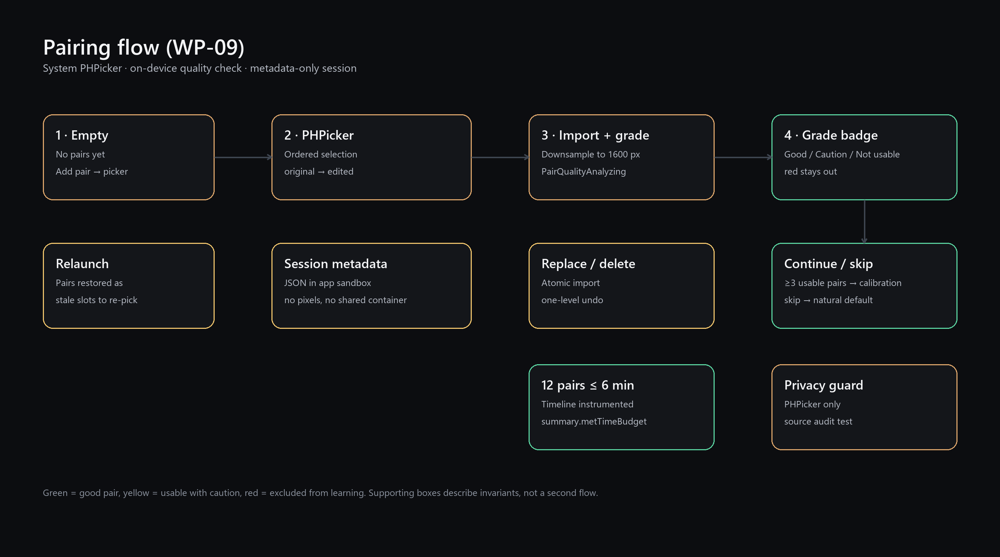
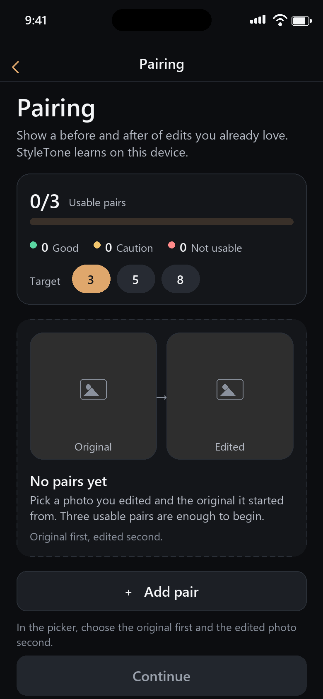
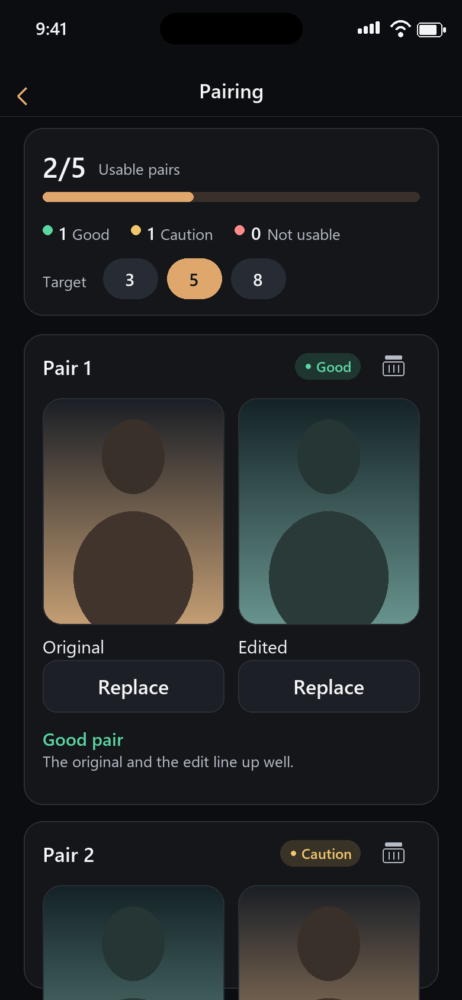
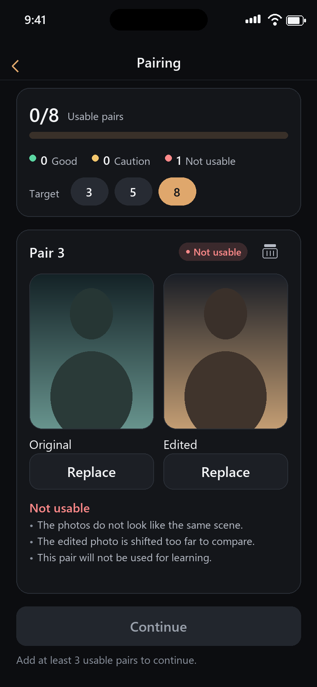
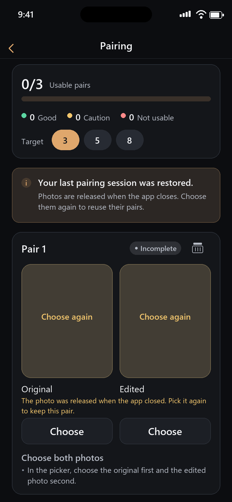
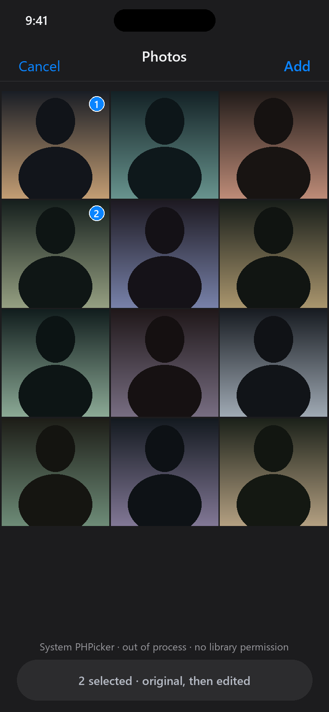

# WP-09 · 配对导入 / 质量检查 UI

- 状态：**review**（代码与测试完成；iOS 构建需 macOS CI）
- 范围：`Packages/StyleToneUI/Sources/StyleToneUI/Pairing/`（SwiftPM target 源码）
- 文档/资产：`Packages/StyleToneUI/Pairing/`（任务卡中的 WP 目录；`README.md`、`screenshots/`、`tools/`）
- 依赖：WP-02 imaging、WP-08 persistence（未落地，见“集成”）、WP-05 `PairQualityAnalyzing`（mock / 注入）
- 解锁：WP-10 校准、WP-18 集成

> 任务卡写的所有权目录是 `Packages/StyleToneUI/Pairing/`，但本仓库 SwiftPM target 的路径是
> `Packages/StyleToneUI/Sources/StyleToneUI`。因此实现放在 `Sources/StyleToneUI/Pairing/`，
> 任务卡目录用来放本文档、截图与渲染脚本；两边都不触碰 `DesignSystem/`、`Calibration/`、`Editor/`。

---

## 1. 交付内容

| 能力 | 实现 |
|---|---|
| PHPicker 选择原图 / 成片 | `PairingPHPicker.swift`：`PHPickerViewController` + `selection = .ordered`、`selectionLimit = 2`；不申请相册权限，不检查 `PHPhotoLibrary` 授权 |
| 单槽替换 / 删除 | `PairingViewModel.pick(_:in:)`、`replace/remove`；整批解码成功后才写入，失败不破坏旧照片 |
| 配对卡片 | `PairingPairCard` + `PairingPhotoSlotView`：双槽预览、替换 / 移除、删除整组 |
| 质量分级 / 原因 | `PairQualityAnalyzing` → `PairQualityPresentation`（绿 / 黄 / 红 + 可读原因 + 重试） |
| 进度 1/3、1/5、1/8 | `PairingTarget.three/five/eight` + `PairingProgress`（`min(usable, target)/target`） |
| 完成 / 跳过 | `finish()` 返回仅含可用配对的 `[PairSample]`；`skip()` 标记自然默认 |
| 会话持久化 | `PairingSessionStoring` + `FilePairingSessionStore`：仅元数据 JSON、原子写、iOS 完整文件保护 |
| 空 / 权限 / 错误态 | 空状态卡、picker 不可用提示 + 重试、导入 / 分析 / 存储错误 banner、恢复会话 banner |
| 无障碍 | 全部可交互元素 `pairing.*` 标识；逐卡片 `pairing.pairN.<slot>.<action>` |
| UI 测试 | 8 个测试类、90 个测试（XCTest，view-model 驱动；XCUITest 待 WP-24） |

---

## 2. 流程



1. **空状态** → “Add pair” 打开系统 PHPicker（先原图、后成片，两张有序）。
2. **导入**：所有选中项先解码（`ImageLoader`，长边 ≤1600），全部成功后才挂到槽位；然后调用
   `PairQualityAnalyzing`。任一步失败都保持原数据不变。
3. **分级**：绿（good）/ 黄（warning，可用）/ 红（rejected，不进入学习）；原因逐条展示。
4. **替换 / 删除**：替换只影响一个槽位并重新分级；删除与移除照片保留一级撤销。
5. **完成**：≥3 组可用配对才可继续；`finish()` 过滤红色配对后交给 WP-10。也可跳过走自然默认。
6. **重开 App**：恢复配对数量 / 目标 / 分级 / 阶段；照片本身不落盘，槽位显示“Choose again”，重选后恢复可用。

### 状态机（`PairingSessionState`）

| 事件 | 结果 |
|---|---|
| `addPair` | 新增空配对（上限 12）；`addPair` 复用最后一次取消留下的空卡 |
| `attach(photo, slot)` | 写入槽位、`contentRevision += 1`、清空旧分级；两槽齐全时记录时间线 |
| `removePhoto` / `deletePair` | 保存一级 undo 备份，进度立即更新 |
| `undoLastDeletion` | 恢复配对（原索引，越界钳制）或照片 + 上一次分级 |
| `begin/complete/failAssessment` | 以 `contentRevision` 防止过期结果覆盖新照片 |
| `rejectIdenticalSelection` | 两槽 `assetIdentifier` 相同 → 红色，不调用分析器 |
| `complete` / `skip` | 进入 `completed` / `skipped`；任何内容修改自动回到 `editing` |

### 学习输入规则

- `learnablePairs` 只包含：两槽都有照片、分级为 `good` 或 `warning`。
- `learnableSamples` 在 **view model 内部** 过滤红色配对，调用方拿不到红色样本。
- 未分级（分析器不可用 / 失败）的配对不计入进度，`Continue` 保持禁用。

---

## 3. 界面

| 空状态 | 分级（绿 / 黄） |
|---|---|
|  |  |

| 红色拒绝 | 恢复会话（仅元数据） |
|---|---|
|  |  |

| 系统 PHPicker（有序多选） |
|---|
|  |

> 截图由 `tools/render_screens.py` 用同一套设计 token 与 `PairingCopy` 文案渲染，是**设计稿级流程图**，
> 不是模拟器截图（本会话是 Windows，没有 macOS/Xcode）。真机界面以 SwiftUI 源码为准。

---

## 4. 集成

`StyleToneUI` 不 import Vision / Persistence。宿主（App composition root）注入协议实现：

```swift
import StyleToneImaging
import StyleToneUI

// App target（可以 import Vision / Persistence）
guard let directory = FilePairingSessionStore.defaultDirectory() else { return }
let store = FilePairingSessionStore(directory: directory)

let dependencies = PairingDependencies(
    qualityAnalyzer: VisionPairQualityAnalyzer(),   // WP-05
    sessionStore: store,                            // WP-08 可替换为自有实现
    imageImporter: PairingImageImporter(),
    availabilityProvider: SystemPairingPickerAvailability(),
    target: .three
)

PairingScreen(
    dependencies: dependencies,
    onFinish: { samples, summary in /* → WP-10 校准 */ },
    onSkip: { summary in /* → 自然默认 */ }
)
```

- `PairingSessionStoring` 是 UI 自己的协议；WP-08 只需新增一个 adapter，不用改 UI，也不产生
  `UI → Persistence` 依赖。
- `PairingDependencies.placeholder` 的 analyzer 会抛 `.invalidState`（fail closed）：在 WP-05 接入前
  配对会显示“质量检查不可用 + 重试”，`Continue` 保持禁用，避免未分级样本进入学习。

---

## 5. 持久化与隐私

| 项目 | 决策 |
|---|---|
| 写入内容 | schema/目标/阶段/时间戳/每对 id/slot 元数据（源尺寸、显示尺寸、字节数、导入时间）/`PairQuality` |
| 不写入内容 | 照片像素、缩略图、文件名、相册路径、导出文件；无 App Group / 共享容器 |
| 文件 | `Application Support/StyleTone/Pairing/pairing-session.json`，≤512KB，`.atomic`，iOS `.completeFileProtection` |
| 兼容 | `schemaVersion`；未知新字段用 `decodeIfPresent` 默认值；损坏 / 不兼容 schema 返回明确错误，不崩溃、不删除原文件 |
| 重启语义 | 照片释放后槽位标记 `needsReselect`，卡片回到“Incomplete / Choose both photos”；重选两张后重新分级 |
| 网络 / 账号 | 无网络代码、无账号、无上传；`PairingPrivacyAuditTests` 静态扫描源码 |

PHPicker 用 `PHPickerConfiguration(photoLibrary: .shared())` 只为拿到不透明的 `assetIdentifier`
（识别“同一张照片被选进两个槽”）；不调用授权 API、不 fetch 相册、不请求完整相册权限。

---

## 6. 无障碍 / 文案

- 屏幕根标识 `pairing.root`（与 `AppRoute.pairing` 一致）。
- 复用冻结标识：`pairing.addPairButton`、`pairing.continueButton`。
- 新增：`pairing.progress`、`pairing.progress.value`、`pairing.counts.*`、`pairing.target.three|five|eight`、
  `pairing.skipButton`、`pairing.emptyState`、`pairing.notice(.actionButton|.dismissButton)`、
  `pairing.saveState`、`pairing.pickerNote`、`pairing.undoBar`、`pairing.undoButton`；
  卡片级 `pairing.pairN[.title|.deleteButton|.quality|.retryButton|.importing]`、
  `pairing.pairN.<original|edited>[.photo|.pickButton|.removeButton|.note]`。
- 文案全部走 `PairingText`（`LocalizationKey` + 英文 fallback），`pairing.*` / `error.pairing.*` 前缀；
  无硬编码中文。
- **契约偏差（需 CCR）**：WP-05 的原因键是 `pair.reason.*`，不在 §8 冻结前缀内。UI 将 11 个已知键映射到
  `pairing.reason.*`，未知键从最后一段 humanize（如 `Brand new reason.`）。WP-26 落地字符串目录前需要
  对齐前缀。

---

## 7. 测试

```bash
# macOS（CI 同款）
swift test --filter Pairing

# 单独跑本 WP 测试类
swift test --filter PairingViewModelTests
swift test --filter PairingSessionStateTests
swift test --filter PairingSessionSnapshotTests
```

| 测试文件 | 数量 | 覆盖 |
|---|---:|---|
| `PairingSessionStateTests` | 19 | 增删改、撤销、红色排除、进度 1/3·1/5·1/8、revision 防过期、时间线 |
| `PairingViewModelTests` | 22 | picker 流程、原子导入、替换失败保旧照、删除/撤销、完成/跳过、权限/错误、恢复、12 组预算 |
| `PairingSessionSnapshotTests` | 12 | 元数据 roundtrip、无像素、缺字段默认值、损坏/超大/不兼容 schema、文件保护路径 |
| `PairingCopyTests` | 15 | 键合法性/唯一性、原因映射、分级展示、错误文案 |
| `PairingImageImporterTests` | 4 | 真实解码：代理长边、源尺寸、过小/损坏/空数据错误 |
| `PairingAccessibilityTests` | 8 | 标识合法性/唯一性/层级/冻结 ID |
| `PairingPrivacyAuditTests` | 4 | 无网络/共享容器/授权/像素写盘；PHPicker 实现；元数据源无图像类型 |
| `PairingScreenTests` | 6 | 屏构造、行号、验收常量、三组完整 UI 脚本、红色排除、预算 |

验收映射：

| 验收 | 证据 |
|---|---|
| 12 组操作 ≤6 分钟目标可测 | `PairingSessionState.timeBudgetSeconds = 360`、`PairingSessionSummary.metTimeBudget`、`testTwelvePairsMeetTheSixMinuteBudget`（300s）/ `testTwelvePairsOverBudgetAreReported`（480s）；真机秒表复核待 WP-24 |
| 替换 / 删除不丢数据 | `testReplacementKeepsTheOtherPhotoAndReassesses`、`testFailedReplacementKeepsTheExistingPhoto`、`testImportIsAtomicWhenTheSecondPhotoFails`、`testDeletePairAndUndoRestoresIt`、`testRemovePhotoAndUndoRestoresGrade` |
| 红色拒绝不进入学习 | `testRedPairIsNeverLearnable`、`testFinishExcludesRejectedPairs`、`testFlowWithOneRejectedPairStillLearnsFromThree`、`learnableSamples` |
| 无完整相册权限也能选图 | PHPicker 独立进程；无授权调用、无相册 fetch（`PairingPrivacyAuditTests`） |
| 照片不复制到共享容器 | `PairingSessionSnapshot` 无 `ImageAsset`/`CGImage`；store 仅 JSON；审计测试禁 `containerURL(forSecurityApplicationGroupIdentifier)` |

---

## 8. 风险 / 未决

1. **CI 未跑**：本会话为 Windows，没有 Swift/Xcode；`swift test`、`xcodebuild` 均未执行。需要在 macOS
   runner 上跑 `swift test` + App build，重点确认 `PairingPHPicker.swift` 的 Swift 6 并发桥接
   （`MainActor.assumeIsolated` + `@preconcurrency` conformance）与 `@Bindable` 本地绑定。
2. **质量分析使用 1600px 代理**：`PairQualityAnalyzing` 只接收 `ImageAsset`，WP-05 的分辨率比值用
   `pixelSize` 计算。两端都大于 1600px 时比值恒为 1，`resolutionReduced/TooLow` 可能不触发。
   建议 CCR：给协议加源尺寸 hint，或由 UI 对分辨率单独做一次全尺寸读取。
3. **WP-05 键前缀**：`pair.reason.*` 不在冻结前缀表内（见 §6），需要 WP-05/WP-26 对齐。
4. **WP-08 未落地**：`FilePairingSessionStore` 是 UI 侧的临时 adapter；若 WP-08 的 `PairSessionRecord`
   采用不同 schema，需要迁移或替换。跨启动只保留元数据是隐私取舍，若产品要求“重启后照片还在”，
   需要 WP-08 在文件保护下实现加密缓存（契约与隐私评审）。
5. **XCUITest 缺失**：仓库没有 UI test target（WP-24 范围）。当前“UI 测试”是视图构造 + 完整交互脚本 +
   无障碍标识契约；真正的点击/截图测试待 UI test target。
6. **性能**：12 组 × 2 张 1600px 代理约 185MB，低于 300MB 预览预算；但导入/分析是串行 await，
   12 组整体耗时仍以真机为准。
7. **截图性质**：`screenshots/*.png` 是 token 级设计稿（Pillow 渲染），不是模拟器截图；仅用于对齐
   布局与文案，不作为运行时证据。

---

## 9. 文件索引

```text
Packages/StyleToneUI/Sources/StyleToneUI/Pairing/
├── PairingTypes.swift              值类型、进度、时间线、删除备份
├── PairingSessionState.swift       纯状态机
├── PairingSessionSnapshot.swift    元数据快照 + 恢复
├── PairingSessionStore.swift       存储协议 / 内存实现 / 文件实现
├── PairingImageImporting.swift     解码、尺寸、导入错误
├── PairingCopy.swift              pairing.* 文案与原因映射
├── PairingQualityPresentation.swift 绿/黄/红展示与错误文案
├── PairingNotice.swift             内联 banner 模型
├── PairingAccessibility.swift      无障碍标识
├── PairingViewModel.swift          业务流程、持久化、错误恢复
├── PairingScreen.swift             主屏
├── PairingProgressHeader.swift     进度 / 计数 / 3·5·8 目标
├── PairingPairCard.swift           配对卡片
├── PairingPhotoSlotView.swift      单槽
├── PairingQualityBadge.swift       分级徽标
├── PairingEmptyStateView.swift     空状态
├── PairingNoticeBanner.swift       banner
├── PairingUndoBar.swift            撤销条
├── PairingPhotoPickerSheet.swift   picker 容器 / 不可用态
├── PairingPHPicker.swift           PHPickerViewController 桥接（UIKit 条件编译）
└── PairingPreviews.swift           DEBUG 预览

Packages/StyleToneUI/Tests/StyleToneUITests/Pairing/   # 90 tests
Packages/StyleToneUI/Pairing/
├── README.md
├── screenshots/*.png
└── tools/render_screens.py
```
