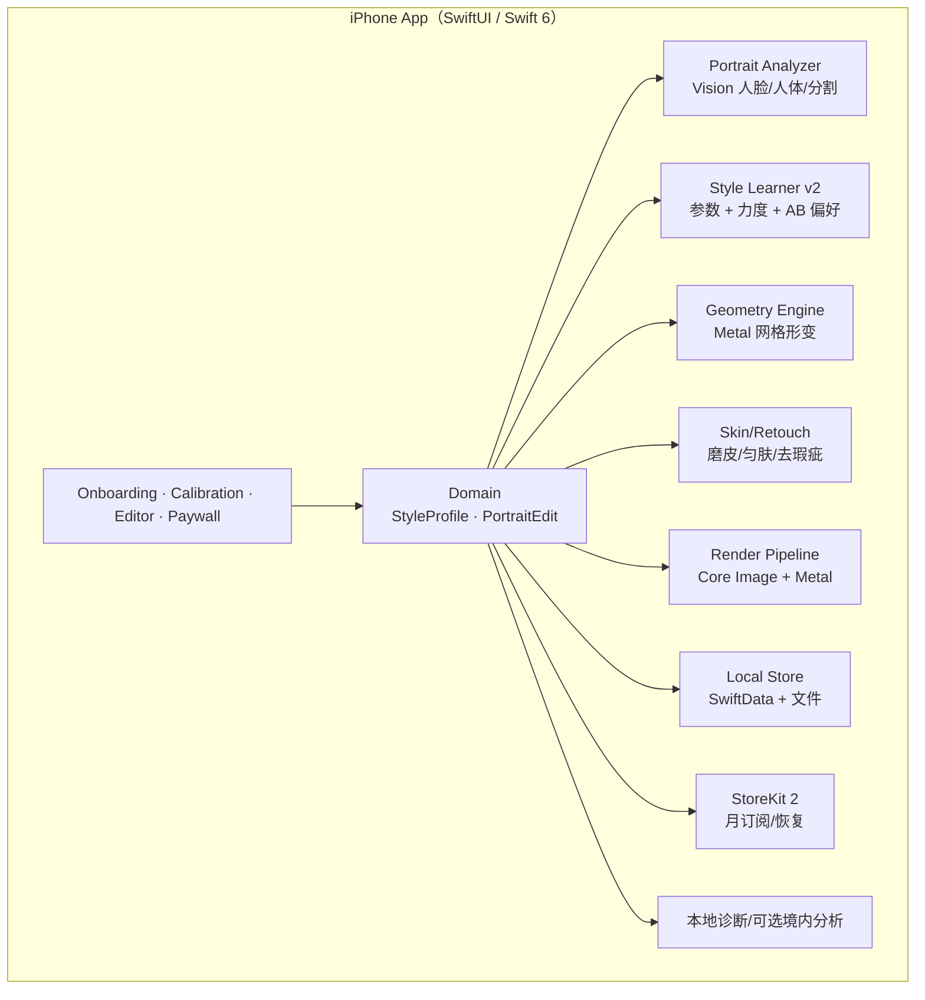

# 02 · 技术架构与算法方案（v3.0 / 纯本地 MVP）

- 文档版本：v3.0
- 日期：2026-10-22
- 状态：中国首发 MVP 技术基线（纯游客、纯本地）
- 关联：[产品需求](01-product-requirements.md) · [开发计划](03-delivery-plan.md) · [中国上线合规](04-launch-compliance.md)

---

## 1. 目标与约束

### 1.1 技术目标

1. 在 iPhone 本地完成人像分析、形变、磨皮、去瑕疵、影调与导出。
2. 形变预览 ≥30fps；12MP 导出 p95 ≤6 秒；5 组风格学习 ≤90 秒。
3. 形变不拉歪背景；肤色覆盖 Fitzpatrick I–VI；默认自然、强度可控。
4. **MVP 无账号、无后端、无照片/参数上传**；风格/编辑只存本机。
5. 中国首发：App 备案、PIPL、隐私政策、境内合规分析（可选）；不接微信/短信/账号 SDK。
6. 订阅仅月付 ¥29.9；StoreKit 2 本地校验，恢复购买依赖 Apple ID。

### 1.2 硬约束

| 约束 | 影响 |
|---|---|
| 纯本地 MVP | 无云端训练/推理/同步；客服看不到用户照片 |
| 人像实时形变 | Vision + Metal；低端机需降级 |
| 背景保护 | 形变质量是核心指标，不能只做“瘦” |
| 18+ 定位 | 不做未成年人营销；隐私政策/年龄提示按法律意见 |
| 中国首发 | App 备案、PIPL、境内分析选型；无境外 SDK |
| 纯游客 | 无账号/登录/注销；无跨设备恢复；订阅靠 Apple ID |
| 擦除 P1 | 需账号/云端，v2.1 单独立项 |

### 1.3 非目标

- 不做换脸、身份替换、生成虚构五官/身体。
- MVP 不做云端修图、物体擦除、账号、同步、批量、多风格、社区。
- 不做专业图层/蒙版/印刷级校色。
- 不做 Android/iPad/Web 首发。

---

## 2. 总体架构（MVP）



**数据边界**：没有任何业务后端；照片、风格、编辑、购买凭证都只在本机。App 的网络请求仅限 StoreKit/Apple 与可选的境内分析（不包含照片）。

---

## 3. 技术选型

| 层 | 选择 | 理由 |
|---|---|---|
| UI | SwiftUI + 少量 UIKit | 开发效率、手势/相册集成 |
| 语言 | Swift 6，严格并发 | 避免渲染/学习数据竞争 |
| 最低系统 | iOS 17 | SwiftData、现代 SwiftUI |
| 图像 | Core Image + 自定义 Metal Kernel | GPU 加速、色彩管理 |
| 检测 | Vision 人脸关键点、人体姿态、人体分割 | 系统内置、本地、无模型下载 |
| 数值 | Accelerate / simd | 网格、滤波、拟合 |
| 持久化 | SwiftData + 文件 | 本地风格/编辑记录 |
| 订阅 | StoreKit 2 | 无账号、无后端；Apple ID 恢复 |
| 分析/崩溃 | 本地环形日志；可选境内合规服务 | 不出境、不含照片 |
| 配置 | 本地默认 + 版本内置开关 | 无远程后端；发版控制 |
| 依赖 | SPM，锁定版本 | 可审计 |

### 3.1 为什么 MVP 不做后端

- 纯游客、纯本地，没有账号/同步/云修图，后端没有必须承载的数据。
- 减少 PIPL/跨境/账号删除/微信审核/服务器运维成本。
- 订阅用 StoreKit 2 本地 JWS 校验；恢复购买由 Apple ID 完成。
- 代价：换机不保留风格；无法远程 Kill Switch；v2.1 再加后端。

### 3.2 为什么不做端侧生成式擦除

- 高质量擦除需要较大模型/算力；端侧质量/包体/发热不可控。
- MVP 不做擦除；v2.1 云端单张授权，单独立项。

---

## 4. iOS 工程架构

### 4.1 模块

```text
StyleToneApp
StyleToneUI
StyleToneCore
StyleToneVision        // 人脸/人体/分割/配准
StyleToneGeometry      // Metal 网格形变/背景保护
StyleToneRetouch       // 磨皮/匀肤/去瑕疵
StyleToneLearning      // 风格/力度/AB 偏好
StyleTonePersistence   // SwiftData/文件/迁移
StyleToneCommerce      // StoreKit 2/权益
```

### 4.2 并发与状态

- 页面 `@Observable` + `@MainActor`；长任务 actor 隔离。
- 形变拖动 → 768px 代理网格 → 30fps；松手 → 高质量重渲染。
- 导出分块 + 后台收尾；取消清理临时文件。
- 学习前台进度、可取消、可暂停；不依赖后台调度。
- 订阅失败/离线不阻塞编辑；恢复购买显式入口。

### 4.3 错误模型

```swift
enum AppError: Error, Sendable {
  case importFailed(ImportFailure)
  case analysisFailed(AnalysisFailure)
  case warpFailed(WarpFailure)
  case retouchFailed(RetouchFailure)
  case learningFailed(LearningFailure)
  case exportFailed(ExportFailure)
  case purchaseFailed(PurchaseFailure)
}
```

每个错误包含用户文案、原因、可执行动作（重试/换图/关闭形变/恢复购买）、诊断码。

---

## 5. 人像处理管线

### 5.1 阶段

```text
解码/方向/色彩
→ 人脸/人体/背景分析
→ 风格参数与推荐力度
→ 人脸/身材形变（Metal，背景保护）
→ 磨皮/匀肤/去瑕疵
→ 影调/色彩/颗粒
→ 输出/编码/元数据
```

### 5.2 分析

| 分析 | 技术 | 用途 |
|---|---|---|
| 人脸关键点 | Vision `VNDetectFaceLandmarksRequest` | 瘦脸/下颌/皮肤区域 |
| 人体姿态 | Vision `VNDetectHumanBodyPoseRequest` | 腰/手臂/腿/拉长锚点 |
| 人体分割 | Vision `VNGeneratePersonSegmentationRequest` | 人/背景分离、形变蒙版 |
| 皮肤概率 | 人脸椭圆 + YCbCr/OKLab 自适应阈值 | 磨皮/匀肤；不按种族分类 |
| 背景结构 | 边缘/直线/矩形检测 + 高梯度图 | 背景保护 |
| 多脸/多人 | 人脸/人体数量与面积 | 提示与按面积处理；不识别身份 |

**失败处理**：无人脸 → 提示“可只用影调/磨皮”；无人体 → 隐藏身材工具；多人 → 提示逐个处理或降低强度。

### 5.3 几何形变

- 网格：预览 32×32 / 导出 64×64；顶点位移 + Metal 纹理采样；边界固定。
- 强度归一化到 `[0,1]`，按脸宽/腰宽/腿长映射最大位移。
- 人脸：瘦脸、下颌；保护眼睛/鼻子/嘴唇/牙齿；发际线/耳朵羽化。
- 身材：瘦手臂、瘦腰、瘦腿；保护手/物体/背景；遮挡低置信度提示。
- 拉长腿：髋部锚点、脚底终点，非线性纵向拉伸；限制 1.00–1.15；边缘延展/镜像填充；提示裁切。
- 背景保护：强边缘/直线惩罚；门框、地砖、桌沿优先；默认开；关闭时二次确认。
- 质量门：明显背景扭曲样本 <5%，投诉 <1%。

### 5.4 皮肤与瑕疵

| 功能 | 方法 | 限制 |
|---|---|---|
| 磨皮 | 引导滤波/双边滤波 + 高频分离 | 保留毛孔；强度上限；不涂抹五官 |
| 匀肤 | 肤色蒙版内低频颜色/亮度均衡 | 不改变肤色色相；不做美白 |
| 去瑕疵 | 点选 → 小范围 patch-based inpainting/纹理合成 | 仅痘/斑/小杂物；可撤销；不改变五官 |
| 黑眼圈/牙齿/眼睛 | v2.1 | 局部颜色/亮度；不改变形状 |

- 肤色蒙版排除眼睛、眉毛、嘴唇；多肤色自适应；不做肤色分类。

### 5.5 影调/色彩

- 曝光、对比、高光/阴影、色温、色调、饱和、颗粒。
- 从配对/AB 学习；限制极端偏色；肤色区域保护。
- 可烘焙 33³ LUT 作为渲染缓存；MVP 先用原生 Core Image 链，LUT 仅在基准证明有收益时启用。

### 5.6 性能预算

| 阶段 | 目标（iPhone 13） | 降级 |
|---|---|---|
| 冷启动 | ≤2s | 延迟加载 |
| 首帧 | p95 ≤1.5s | 1536px 代理 |
| 形变预览 | ≥30fps | 768px 网格；低端 24fps |
| 滑杆 | ≤100ms | 代理渲染 |
| 5 组学习 | ≤90s | 640px 代理 |
| 8 组学习 | ≤150s | 同上 |
| 12MP 导出 | p95 ≤6s | 分块 |
| 48MP 导出 | ≤20s 或提示 | 限制/降级 |
| 内存 | 预览 ≤300MB；导出 ≤500MB | 分块/释放 |
| 热 | 连续 15 分钟不严重降频 | 降分辨率/提示 |

---

## 6. 风格学习 v2

### 6.1 输入

- 3–8 组配对（推荐 5 组），同场景、人脸清晰、构图接近。
- 6–8 次 A/B 选择（肤色、磨皮、脸型、身材、影调、自然度）。
- 可选：用户在 App 内的调整（需明确“记住这次调整”）。

### 6.2 输出参数

```json
{
  "schemaVersion": 2,
  "algorithmVersion": "st-3.0.0",
  "confidence": "standard",
  "pairCount": 5,
  "tone": {"exposure": 0.08, "contrast": 0.05, "highlights": -0.12, "shadows": 0.06, "temp": 180, "tint": 0.01, "saturation": 0.03},
  "skin": {"smoothing": 0.35, "evenness": 0.25, "blemish": 0.2},
  "face": {"slim": 0.28, "jaw": 0.22},
  "body": {"arm": 0.15, "waist": 0.18, "leg": 0.12, "legLength": 1.04},
  "finish": {"grain": 0.08, "vignette": -0.05},
  "guardrails": {"maxStrength": 1.5, "naturalDefault": 0.7, "backgroundProtection": true}
}
```

### 6.3 学习步骤

1. 配对/选择质量检查：人脸、配准、分辨率、结构改动。
2. 影调/肤色：直方图/分位数匹配 + 鲁棒色彩矩阵；肤色区域单独拟合。
3. 磨皮/匀肤：估计高频能量差与肤色均匀度；限幅。
4. 脸型/身材力度：从关键点位移/轮廓比估计；只学“默认力度”。
5. A/B 偏好：6–8 次选择转成参数偏好的成对约束；逻辑回归/贝叶斯更新。
6. 聚合/正则：3 组强收缩到自然默认；5 组标准；8 组稳定；异常样本降权。
7. 留出验证：留 1 组评估；误差高则降低置信度/推荐力度。
8. 风格卡：标签、置信度、推荐力度；可手动覆盖。

### 6.4 边界

- 不自动应用高强度形变：只给默认值，首屏可见可调；自然档 70%。
- 不从单张图推断身材缺陷；不做身体测量。
- 不做身份/人脸识别；关键点只用于形变/蒙皮。
- 不把照片/参数上传或用于训练。

### 6.5 置信度

| 层级 | 条件 | UI |
|---|---|---|
| 试用 | 3–4 组或仅 A/B | “试用风格，建议补充样本” |
| 标准 | 5–7 组 | “已学会你的基础偏好” |
| 稳定 | ≥8 组且留出误差低 | “稳定风格” |
| 自然默认 | 未校准/检测失败 | “非个性化，可随时校准” |

---

## 7. 本地数据与订阅

### 7.1 本地数据

```text
StyleProfile(id, schema, algorithm, pairCount, confidence, paramsJSON, tags, updatedAt)
PortraitEdit(id, styleID, inputRef, adjustmentsJSON, createdAt, exported)
PairSession(id, pairCount, abChoices, status)
Consent(localAnalytics, diagnostics, version)
Quota(freeExportsUsed)
```

- 照片、缩略图、风格、编辑记录全部本地；不使用云同步。
- 删除数据：清空 SwiftData、文件、缩略图、缓存；配额重置可接受。
- 无账号、无云端删除请求；无需账号注销入口。

### 7.2 订阅（仅月付）

- 商品：`com.styletone.pro.monthly`，¥29.9/月；若 App Store 无此价格点，用最近可用价（如 ¥30）。
- StoreKit 2 本地 JWS 校验；恢复购买依赖 Apple ID；离线保留已购权益（3–7 天宽限）。
- 前 3 次成功导出免费；保存/分享均计数；失败/取消不计。
- 付费墙必须展示价格、周期、自动续订、取消方式、恢复购买、隐私政策、服务条款。
- 无年付/买断/账号；后续数据验证后再评估。
- 订阅由 Apple ID 管理；删除 App 不取消订阅，帮助页说明。

---

## 8. 安全与隐私

### 8.1 数据边界

| 数据 | 位置 | 是否上传 | 保留 |
|---|---|---|---|
| 原图/成片 | iPhone | 否 | 用户删除/导出后清理 |
| 缩略图/风格卡 | iPhone | 否 | 删风格即删 |
| 风格/编辑参数 | iPhone | 否 | 直到删除 |
| 购买凭证 | iPhone/Apple | 仅 Apple | 按 Apple 政策 |
| 诊断/分析 | iPhone + 可选境内服务 | 可选、无照片 | 90 天，聚合 |

### 8.2 安全措施

- 文件 `NSFileProtectionComplete`；临时导出文件及时删除。
- Keychain 存购买权益缓存；无账号 token/密码。
- 日志禁止照片、文件名、相册 ID；使用随机任务 ID。
- App 切换器隐私遮罩；不截屏敏感页面。
- 若接入境内分析，必须事件白名单、无 PII、可关闭。

### 8.3 无账号的合规简化

- 不需要账号注销/数据导出接口。
- 不需要微信/短信/Apple 登录 SDK。
- 不需要处理手机号/openid/unionid。
- 仍需 App 备案、隐私政策、相册权限文案、订阅条款、PIPL 告知。

---

## 9. v2.1 账号与云端擦除（设计预留，不实现）

### 9.1 触发条件

- MVP 留存/付费达标；擦除需求强；有后端/GPU/合规预算。
- 预计 +8–12 周，团队增加后端/安全运维。

### 9.2 架构

```text
账号：微信/手机号/Apple → 境内 BFF → PostgreSQL/Redis
同步：风格参数/偏好（不含照片）
擦除：登录 → 画笔蒙版 → 单张授权 → 加密上传
→ GPU inpainting → 内容审核 → 下载 → 24h 删除
```

- 账号只同步参数；照片仅云擦除时上传。
- 云擦除需要：账号、额度、对象存储、GPU worker、审核、生成式 AI 标识、数据保留/删除。
- 不用用户照片训练；不保留超过 24 小时。
- 单独立项，不在 24 周 MVP 内。

---

## 10. 测试与质量

### 10.1 样本集

- 脸型/体型/肤色（Fitzpatrick I–VI）/年龄/发型/遮挡/多人。
- 背景：门框、地砖、桌沿、栏杆、文字、建筑、纯色墙、复杂图案。
- 光线：自然光、室内暖光、逆光、夜景、闪光。
- 设备：iPhone 12/13/15/当前 Pro；iOS 17/当前-1/当前。
- 格式：HEIC/JPEG/PNG、P3/sRGB、12MP/48MP。

### 10.2 指标

- 背景直线/边缘保持；人脸/人体自然度；肤色一致性；纹理保留。
- 形变前后身份可识别（人工盲测，不做人脸识别）。
- 预览帧率、导出耗时、内存、热。
- 隐私：抓包确认无照片/参数上传；日志无 PII。

### 10.3 门禁

- 背景明显扭曲 <5%；投诉 <1%。
- 盲测偏好 ≥65%（外部 Beta 前）。
- 崩溃自由 ≥99.5%；导出失败 <1%。
- 5 组学习 ≤90s；预览 ≥30fps；12MP 导出 ≤6s。

---

## 11. 技术 Spike

| Spike | 问题 | 通过标准 | 失败预案 |
|---|---|---|---|
| S1 形变 | 瘦脸/腰/腿是否自然、背景是否稳 | 100 张明显扭曲 <5% | 降强度/只做脸/腰；腿拉长后置 |
| S2 皮肤 | 多肤色磨皮/匀肤是否安全 | 无过亮/偏灰；纹理保留 | 关闭匀肤；只做轻度磨皮 |
| S3 风格 | 3/5 组 + AB 是否有效 | 盲测 ≥65% | 提高样本门槛/缩参数 |
| S4 性能 | 30fps/6s/90s 是否达标 | iPhone 13 达标 | 降代理/网格；低端限制 |
| S5 订阅/合规 | StoreKit 月付/恢复/App 备案 | 真机购买/恢复/备案材料受理 | 先提审前解决；不接后端 |

**决策门**：S1/S2 未通过，不进入全量开发；S3 未通过，只做“自然默认 + 手动工具”；S4 未通过，降级；S5 未通过，调整上线时间。

---

## 12. 技术待决问题

1. 形变网格 32×32 是否足够？是否需要 64×64 导出？
2. 背景保护用直线检测 + 边缘惩罚，还是引入轻量分割模型？
3. 去瑕疵用 patch-based 还是 Core ML 小模型？质量/包体权衡。
4. 3 组样本 + AB 的盲测能否达到 65%？需要 W2 验证。
5. ¥29.9 是否为中国区可用价格点？若否，映射到 ¥30 或最近档。
6. v2.1 账号/擦除的后端与 GPU 方案、预算、合规。
