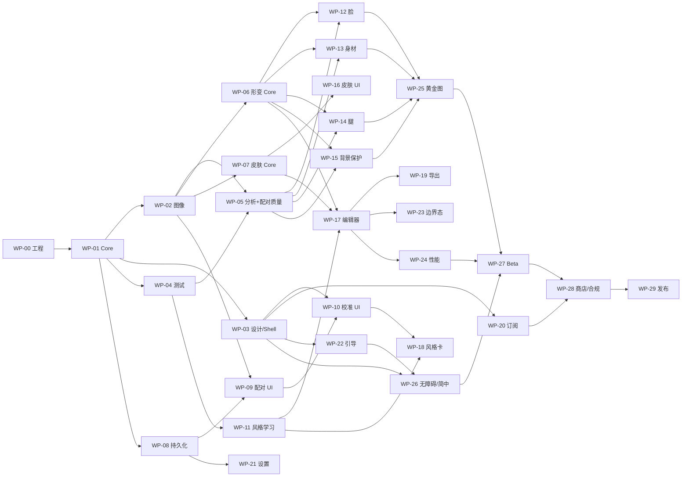

# 10 · 可并行开发任务分解

- 文档版本：v1.0
- 日期：2026-10-22
- 适用基线：**原生 iOS、纯本地、24 周 / 250 PD、66 个原子任务**
- 目标：把 MVP 拆成 **30 个工作包（Work Package, WP）**，每个包可由一个独立会话领取、实现、测试、交付，减少互相等待与文件冲突。

> 这份目录不是“任务清单”，而是**可交接的工程合同**：每个 WP 都有所有权边界、依赖、验收标准、测试命令和可直接复制的开发 Prompt。

> 需要直接开独立会话时，用 [独立/并行开发 Prompt 包](../12-session-prompts.md)：30 段可复制 Prompt，按 A0–A5、B、C 批次编排。

---

## 1. 使用顺序（非常重要）

### 第一步：完成 Wave 0，冻结契约

Wave 0 是**串行门禁**，不要在它完成前让多个会话同时写业务代码：

| WP | 内容 | PD |
|---|---|---|
| WP-00 | 仓库/XcodeGen/模块骨架/CI | 8 |
| WP-01 | Core 领域模型、协议、错误、JSON schema | 9 |
| WP-02 | 图像 I/O、方向、色彩、编码 | 9 |
| WP-03 | 设计系统、App Shell、路由 | 9 |
| WP-04 | 测试 Harness、合成 Fixtures、黄金图工具 | 7 |

**Wave 0 出口条件**：

- `xcodegen generate` + `xcodebuild` 可构建；
- 所有模块可编译、可跑空测试；
- `StyleToneCore` 契约打 tag `core-v1`；
- 设计 token/路由/无障碍 ID 规范冻结；
- CI 在 macOS runner 上跑通；
- 每个 WP 的文件所有权已确认。

### 第二步：Wave 1 并行核心引擎

| WP | 内容 | PD | 可并行 |
|---|---|---|---|
| WP-05 | 人像分析（人脸/人体/分割/皮肤/背景边缘） | 11 | 是 |
| WP-06 | 网格形变引擎（Metal Core） | 10 | 是 |
| WP-07 | 磨皮/匀肤/去瑕疵 Core | 11 | 是 |
| WP-08 | 本地持久化与迁移 | 6 | 是 |
| WP-09 | 配对导入/质量检查 UI | 9 | 是 |
| WP-10 | 3/5/8 校准 + AB UI | 10 | 是（用 mock learner） |
| WP-11 | 风格学习（色彩+力度+置信度） | 8 | 是 |

> Phase A 的 Wave 1 启动 WP-05/06/07/08/09/10/11（核心闭环必须包含配对/学习）；WP-18/22/27 属于 Phase B。

### 第三步：Wave 2 功能工具与页面

| WP | 内容 | PD |
|---|---|---|
| WP-12 | 瘦脸/下颌工具 | 8 |
| WP-13 | 瘦手臂/腰工具 | 7 |
| WP-14 | 瘦腿/拉长工具 | 6 |
| WP-15 | 背景保护 | 8 |
| WP-16 | 皮肤工具 UI + 点选去瑕疵 | 10 |
| WP-17 | 编辑器状态/预览/撤销 | 12 |
| WP-18 | 风格卡/档案管理 | 6 |
| WP-19 | 导出/相册/分享 | 8 |
| WP-20 | 订阅/付费墙/恢复 | 8 |
| WP-21 | 设置/隐私/诊断 | 6 |
| WP-22 | 引导/示范/空状态 | 8 |

### 第四步：Wave 3 集成、质量与上线

| WP | 内容 | PD |
|---|---|---|
| WP-23 | 错误/离线/边界态 | 7 |
| WP-24 | 性能/内存/热优化 | 11 |
| WP-25 | 黄金图与质量回归 | 12 |
| WP-26 | 无障碍/简中/本地化 | 5 |
| WP-27 | Beta/TestFlight/反馈 | 8 |
| WP-28 | App Store/备案/隐私/提审 | 8 |
| WP-29 | 发布/Runbook/复盘 | 5 |

**合计：30 WP / 250 PD**，与 [开发计划](../03-delivery-plan.md) 一致。

### 按交付阶段领取

| 阶段 | WP | PD | 交付 |
|---|---|---|---|
| **Phase A 自用** | WP-00~11、12~17、19、21、23~25（23 个） | 202 | 16–18 周；核心配对学习闭环 |
| **Phase B 朋友** | WP-18、22、27（3 个） | 22 | 4–5 周；风格卡/引导/TestFlight |
| **Phase C 商业化** | WP-20、26、28、29（4 个） | 26 | 6–8 周；App Store + 月订阅 |

> Phase A 对 WP-21/23/24/25 采用 Lite 验收（自己的机型、20–30 张样本、自用高频场景），可省 15–20 PD；但核心闭环仍按 202 PD / 16–18 周估算。Phase A 不做 WP-18/20/22/26/27/28/29。

---

## 2. 并行轨道（建议 6–8 个会话）

Wave 0 完成后，可按以下轨道并行：

| 轨道 | WP | 说明 |
|---|---|---|
| A 视觉/几何 | WP-05、06、12、13、14、15 | 同一模块不同子目录；共享 Core API 冻结 |
| B 皮肤/风格 | WP-07、11、16 | 先用 mock 分析/样本，不等 WP-05 |
| C 应用/UI | WP-03、09、10、17、18、22 | 页面之间通过路由/协议解耦 |
| D 数据/商业 | WP-08、19、20、21 | StoreKit/持久化可独立测试 |
| E 质量/发布 | WP-04、23、24、25、26、27、28、29 | 越早介入越好，不要等到最后 |

**同时开工建议（Wave 1 第一周）**：WP-05、WP-06、WP-07、WP-08、WP-09、WP-10、WP-11 各一个会话。



---

## 3. 每个工作包的所有权规则

1. **只改自己 `Owns` 的路径**；不要改其他 WP 的目录。
2. **不要改 `StyleToneCore` 的公开契约**；需要改时走 CCR（见第 5 节）。
3. 不要新增第三方依赖；需要时先提案。
4. 不要新增网络图片上传、账号、云服务；MVP 纯本地。
5. 每个 WP 必须带自己的单元测试；集成测试由 WP-24/25 负责。
6. 产物必须是可合并的 Swift Package / App 代码，不是伪代码。
7. 所有用户可见文案走 `Localizable.xcstrings`，key 由 WP-03 统一。
8. 所有无障碍 ID 用 `screen.element` 规范，例如 `editor.faceSlimSlider`。
9. 不提交真实用户照片；测试只用合成图/授权样本。
10. 不把照片、文件名、相册 ID 写进日志。

### 文件所有权总表

| 路径 | 所有者 | 说明 |
|---|---|---|
| `project.yml`、`Package.swift`、`App/StyleToneApp.swift`、`.github/` | WP-00 | 工程与 CI |
| `Packages/StyleToneCore/` | WP-01 | 契约冻结，只读 except CCR |
| `Packages/StyleToneImaging/` | WP-02 | 解码/色彩/编码 |
| `Packages/StyleToneUI/DesignSystem/`、`App/AppShell/` | WP-03 | 设计系统/路由 |
| `Tests/Shared/`、`Fixtures/`、`Tests/GoldenSupport/` | WP-04 | 测试基础设施 |
| `Packages/StyleToneVision/` | WP-05 | 分析 |
| `Packages/StyleToneGeometry/Core/` | WP-06 | 网格/材质/边界 |
| `Packages/StyleToneGeometry/Face/` | WP-12 | 瘦脸/下颌 |
| `Packages/StyleToneGeometry/Body/` | WP-13 | 手臂/腰 |
| `Packages/StyleToneGeometry/Legs/` | WP-14 | 腿/拉长 |
| `Packages/StyleToneGeometry/Background/` | WP-15 | 直线/边缘保护 |
| `Packages/StyleToneRetouch/` | WP-07 | 磨皮/匀肤/修复 Core |
| `Packages/StyleToneLearning/` | WP-11 | 风格学习 |
| `Packages/StyleTonePersistence/` | WP-08 | SwiftData/迁移 |
| `Packages/StyleToneCommerce/` | WP-20 | StoreKit |
| `Packages/StyleToneUI/Pairing/` | WP-09 | 配对导入 |
| `Packages/StyleToneUI/Calibration/` | WP-10 | 校准/AB |
| `Packages/StyleToneUI/Editor/` | WP-17 | 编辑器壳 |
| `Packages/StyleToneUI/SkinTools/` | WP-16 | 皮肤工具 |
| `Packages/StyleToneUI/StyleProfile/` | WP-18 | 风格卡/档案 |
| `Packages/StyleToneUI/Settings/` | WP-21 | 设置/隐私 |
| `Packages/StyleToneUI/Onboarding/` | WP-22 | 引导/示范 |
| `Tests/Integration/` | WP-24/25 | 集成/黄金图 |
| `docs/` | 只读 | 任务卡不参与代码修改 |

---

## 4. 交付流程（每个会话照做）

1. 从 `docs/10-task-decomposition/index.csv` 找到 `status=ready` 且依赖已 `done` 的 WP。
2. 读：
   - `docs/10-task-decomposition/README.md`（本文件）
   - `docs/10-task-decomposition/contracts.md`
   - `docs/10-task-decomposition/task-cards.md` 对应 WP
   - 相关产品/技术文档章节
3. 创建分支：`wp-XX-short-slug`。
4. 只改 `Owns` 路径；实现 + 单测 + 必要的 Preview/Mock。
5. 运行本 WP 的测试命令；如果当前环境是 Windows、无法跑 iOS，必须：
   - 推分支触发 macOS CI；
   - 在报告里写 `CI_PENDING` / `BUILD_UNVERIFIED_ON_WINDOWS`；
   - **不能写“测试通过”**。
6. 提 PR，描述中附：
   - 完成的验收项；
   - 测试命令/结果；
   - 未决问题/契约变更请求；
   - 截图（如 UI）。
7. 项目负责人更新 `index.csv` 的 `status`，不要由多个会话并发改同一行。

### 状态

`blocked` → `ready` → `in_progress` → `review` → `done`

- `blocked`：依赖未完成；
- `ready`：依赖完成/可用 mock；
- `in_progress`：已认领；
- `review`：PR 待审；
- `done`：合并 + CI 绿灯 + 验收通过。

---

## 5. 契约变更（CCR）

以下情况必须先提 **Contract Change Request**，不能直接改：

- 修改 `StyleToneCore` 的公开类型/协议/错误；
- 修改 `ImageAsset` 的像素格式/色彩空间约定；
- 修改渲染管线顺序；
- 修改 `StyleProfile` JSON schema；
- 修改文件所有权/模块边界；
- 新增第三方依赖。

流程：

1. 在 `docs/10-task-decomposition/contract-change-requests/CCR-YYYYMMDD-XX.md` 写：
   - 动机、影响模块、兼容性、迁移方案、测试计划。
2. 由 WP-01 所有者 + Tech Lead 审核。
3. 合并后更新 `contracts.md` 与 `core-v1` tag。
4. 其他 WP 再同步升级。

> 如果不等 CCR，先在本地用 protocol/mock 适配，不要改共享契约。

---

## 6. 完成定义（DoD）

每个 WP 必须满足：

- [ ] 只改 Owns 路径；
- [ ] 公开 API 有 DocC 注释；
- [ ] 单元测试覆盖核心路径；
- [ ] 错误/取消/空输入有处理；
- [ ] 无照片/文件名/相册 ID 日志；
- [ ] 无网络图片上传；
- [ ] 性能在卡片预算内；
- [ ] 可访问性 ID/文案按规范；
- [ ] CI 绿灯（或明确 CI_PENDING）；
- [ ] PR 描述含验收/测试/风险；
- [ ] 不引入未批准依赖。

---

## 7. 可直接复制的通用 Prompt

```text
你在 D:\AI\Personalized-ps 实现 WP-XX（<标题>）。

先读：
1. docs/10-task-decomposition/README.md
2. docs/10-task-decomposition/contracts.md
3. docs/10-task-decomposition/task-cards.md 的 WP-XX 小节
4. docs/01-product-requirements.md 与 docs/02-technical-architecture.md 的相关章节

硬约束：
- 只改 task card 的 Owns 路径，不改 StyleToneCore 公开契约。
- 不新增第三方依赖、不接网络/账号/云、不上传照片。
- Swift 6 / iOS 17 / SwiftUI；所有公开 API 有注释。
- 写单元测试；UI 任务加 accessibilityIdentifier。
- 如果当前是 Windows，无法跑 iOS 构建：推分支触发 macOS CI，报告写 CI_PENDING，不要声称测试通过。

交付：
- 代码 + 测试 + 必要 mock/preview；
- PR 描述：完成项、测试命令/结果、风险、后续；
- 如契约不足，写 CCR，不要擅自改 Core。

完成后按 task card 的验收标准逐条自查。
```

---

## 8. 第一批可以立即领取的 WP

Wave 0 完成后：

- WP-05 人像分析
- WP-06 网格形变 Core
- WP-07 皮肤 Core
- WP-08 持久化
- WP-09 配对导入
- WP-10 校准 UI
- WP-11 风格学习

Wave 0 期间不要并行写业务代码；先让契约稳定，后面才快。
